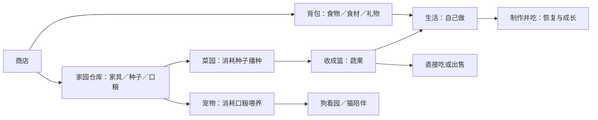

# 商品系统方案 · 第二阶段审核稿

状态：第一阶段分类与优先顺序、第二阶段方案均已获作者确认；第三阶段数值稿见 [SHOP-DESIGN-03-BALANCE.md](SHOP-DESIGN-03-BALANCE.md)。尚未改动线上商品与玩法。项目：BraveLife 勇敢人生，自研生活经营游戏。日期：2026-11-03。

## 1. 设计目标

让购买服务于“安排自己的生活”，形成采购、种植、照料、料理的连续体验。单人能独立完成，未来圈子玩家能交流采购与种植策略；不强制组队，不通过付费道具破坏狗的守园规则。

首发四类食物、食材、礼物、家具保留；按作者确认顺序加入种子、普通口粮、自家料理。此次先确定规则与操作路径，新增定价和恢复量放到第三阶段推演。

## 2. 系统结构

这里的家园仓库是统一查看入口；不要求立刻把已有家具、收成、背包的数据全部搬到一个容器。每件物品只存一份，分类视图读取原库存。家园菜单仍保留仓库，商店仍是独立一级入口。

## 3. 核心规则

### 3.1 种子：先备货，再安排种植

| 商品 | 购买得到 | 使用位置 | 经营选择 |
|---|---|---|---|
| 萝卜种子 | 一份萝卜种子 | 家园菜园空地 | 较短等待，安排近期收成 |
| 番茄种子 | 一份番茄种子 | 家园菜园空地 | 中期收成，接入复合料理 |
| 草莓种子 | 一份草莓种子 | 家园菜园空地 | 较长等待，用于水果餐 |

一次成功播种消耗一份对应种子，只在地块可种且主人在家时扣除。失败、重复点击、地块已占用都不扣种子。买种子不直接种下，也不增加收益。

菜园保留选作物和点空地的轻操作。种子不足时显示“种子不足”和“补货”；补货切换到同一个商店浮层并筛选对应种子，不叠第二个窗口，也不自动付款。购买后显示“去播种”，回到原家园，原地块需要重新确认。

现有播种直接扣钱的规则，在种子库存上线时由“扣种子”取代，不能同时扣钱。原有在地作物和生长进度不变；旧存档新增种子库存默认为空，不追扣过去播种费用。

### 3.2 普通口粮：库存与喂养状态分开

| 商品 | 用途 | 不承担的功能 |
|---|---|---|
| 普通狗粮 | 喂养已领养的小狗 | 不提高守园成功率、不阻止自然饥饿 |
| 普通猫粮 | 喂养已领养的小猫 | 不直接购买心情、不代替陪伴互动 |

买入只增加库存，不自动喂养。喂养必须在家，并已有对应宠物。缺粮提示去补货；未领养时提示“尚未领养”，可以买来准备但不自动领养。领养入口继续放在宠物页，已有领养赠送的饱腹时长保持原到期时间。

建议新规则用“每份固定时长＋储粮上限”：当前剩余量容得下一份才允许喂养；喂养后在剩余时间上追加一份，不覆盖已有剩余时间。已饥饿时从当前现实时间开始计算。份量、价格、上限在下一阶段确定，避免沿用旧“补满两天”文案却偷偷损耗剩余粮。

饱腹、睡觉与库存分别展示。例如“狗粮×3”“看园中”“剩余约一天”，不能把“仓库有粮”误表示成“狗已吃饱”。停止旧喂养入口直接扣现金，所有入口共用一次扣粮。旧存档已付费取得的饱腹时长不折算、不回收。

狗饱腹且在园时绝对不能偷菜；狗饿后回房睡觉，睡觉体力消耗极小；狗离园且主人不在才允许偷菜。猫仍通过实际陪伴触发原有心情奖励，买粮、喂粮不额外叠加心情奖励。不上架安眠药、引狗食物、守园豁免道具。

### 3.3 自家料理：先把自己的收成吃出用途

首轮新增三道料理候选；原有蔬菜包、鲜鱼、和牛做饭继续可用。

| 料理候选 | 材料来源 | 前置 | 体验定位 |
|---|---|---|---|
| 萝卜清汤 | 自种萝卜 | 在家，已摆放炉具或厨房 | 最短的“种出来、做着吃”闭环 |
| 番茄鱼汤 | 自种番茄＋商店鲜鱼 | 在家，已摆放炉具或厨房 | 自种与采购搭配，提升生活质量 |
| 草莓果盘 | 自种草莓 | 在家，无需炉具 | 没有厨房时也能享用收成；不按烹饪训练发奖 |

本轮沿用“做完当餐吃”的方式，不先建立成品库存、保鲜或多人分餐系统。按钮明确叫“制作并吃”，果盘叫“切盘吃”，不让玩家误以为得到可交易成品。

每道配方展示材料“拥有／需要”、耗时、预期属性变化和厨艺收益；缺材料时禁用并指出缺项。材料份数、耗时、恢复量、技能收益待第三阶段确定。熟食满足条件后记录一次料理和一次用餐；水果餐只记录一次用餐，不冒充厨艺训练。

直接吃、料理、出售读取同一收成数量。料理确认时一次校验所有材料，全部满足才一起扣除；不能先扣萝卜后发现缺鱼。新增菜谱的收益不能简单高于食材直接吃与售卖的所有选择，平衡时须计入时间、等待、厨房投入和厨艺。

### 3.4 圈子联动边界

第一版商品循环无需好友也能完整体验。产品信息和策略说明可以为未来圈子分享准备，但不虚构“共享库存已上线”。后续先做采购清单和菜谱策略分享，再研究本人授权赠送、共享餐食与贡献结算。

圈子规模不硬限制为3—8人；共享规则应按成员权限与贡献设计。首次引入跨玩家交易时，必须用共同可信的库存与结算记录处理，不能仅凭浏览器本地库存赠送。商品系统不改写个人主线；以后用种植选择、互助与聚餐事件影响各自主线，避免购买道具直接指定别人结局。

## 4. 页面与操作路径

| 目的 | 路径 | 结束后的反馈 |
|---|---|---|
| 买种子 | 商店 → 园艺 → 购买 | 数量＋余额更新，“去播种” |
| 播种 | 家园 → 选作物 → 点空地 | 扣种子，幼苗出现，显示现实剩余时间 |
| 喂狗／猫 | 家园 → 宠物 → 喂养 | 扣对应口粮，看园／陪伴状态刷新 |
| 用收成做饭 | 生活 → 自己做 → 菜园菜谱 → 制作并吃 | 显示消耗、恢复、成长的短提示 |
| 查库存 | 家园 → 仓库 → 家具／种子／口粮 | 选家具进入摆放；种子、口粮引导对应使用处 |

商店扩为六类：食物、食材、礼物、家具、园艺、宠物。手机分类采用一条横向可滑动栏，选中项自动进入可见区域；不把六个分类挤成难点的小字。PC仍用同一条分类栏，宽度足够时全部显示。

所有页面复用当前按钮上方的浮层。页头是名称与关闭按钮，中部为分类与商品短列表，底部显示反馈；长内容在窗内滚动，背景场景固定。点击窗口外只收起；窗口内滚动、购买和分类点击不触发背后场景。去补货时替换当前浮层，返回时恢复原功能与筛选，不堆叠弹窗。

单件商品卡优先展示：小插画、名称、用途一句话、已有数量、价格和“购买”。库存上限启用后同时显示剩余容量。详细说明在卡片内部展开，不再打开覆盖主场景的详情大窗。高价商品的确认可在原卡内显示总价与“确认／取消”，普通单件购买直接反馈。

## 5. 视觉与状态设计

延续现有水彩场景、半透明米色纸面、细金边与深色指令栏，强调色使用现有金色，不新增一套稀有度彩虹色。商品插画以可辨识的小物件为主；种子袋区分作物标记，猫粮与狗粮有对应轮廓。首轮资源可以沿用图标验证体验，再替换正式美术。

| 状态 | 展示与操作 |
|---|---|
| 空库存 | “还没有种子”／“还没有口粮”，提供去商店入口 |
| 无厨房 | 配方保留展示，说明缺炉具并提供商店家具入口；果盘仍可用 |
| 资金不足 | 显示差额，禁用购买；不跳转充值 |
| 材料不足 | 标明具体缺项；已拥有的材料不预扣 |
| 加载／提交中 | 同一按钮显示处理中并禁用；不要先显示成功 |
| 保存失败 | 提示失败并保留可重试状态；不重复扣款，已发生的变化需恢复或有持久记录 |
| 库存／储粮已满 | 显示已满，禁用操作；不能悄悄吞掉物品 |
| 成功 | 简短提示数量变化；不弹全屏庆祝，不打断主场景 |

## 6. 兼容与验收边界

- 种植和宠物计时继续使用现实时间，料理和人物行动继续使用人生时钟；加速人生不能加速菜园或口粮消耗。
- 旧存档恢复后，金钱、收成、家具、在地作物及宠物到期时间完整保留；新增库存字段自动补默认值。反复恢复不重复赠送物品。
- 把系统时间回拨不增加成长或饱腹；新增口粮须跟随菜园已推进的时间基准结算，不能各用各的时钟。
- 满地、缺粮、非在家、资金不足、配方缺项、连续点击和买后刷新均要有针对性验收。
- 事务先后顺序与提交锁必须覆盖所有共用入口，不能只在商店按钮上禁用。多人交易另需服务端验证。
- 本轮不加入作物死亡、成熟腐烂、饥饿致死或每日强制登录惩罚，保留慢慢经营的体验。

## 7. 开放问题／风险项

1. 建议批准本稿的库存扣除规则与三道菜谱候选，再进入价格、份量、耗时和恢复量设计。
2. 固定份量口粮与旧“现金补满”是明确的规则转换。需要在下一阶段比较实际日均开销、上线频率及狗守园覆盖，避免不经意变成必须高频登录。
3. 全局商店弱化出门采购理由。建议本轮维持同品同价、不临时加价；地点店铺的独家商品与故事功能单独设计。
4. 家园仓库新增种子、口粮视图后，背包、收成篮的入口说明必须一致；避免复制库存制造多份资产。
5. 新料理定价不是单看恢复量：仍需计入现实成长时间、被偷的保留份额、人物做饭耗时和厨房沉没成本。
6. 真实圈子协作仍属后续范围，本稿不以社交奖励迫使单人转多人。

依据：第一阶段作者确认（2026-11-03）；src/game/data/world.js、garden.js；src/game/engine/garden.js、garden-model.js、actions.js；现有半透明浮层实现（工作区，2026-11-03）。本稿属于设计方案，非已上线功能清单。
