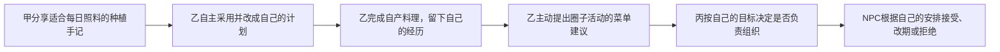

# 商品机制联动 · 第四阶段审核稿

审核进度：作者已确认本阶段，并授权汇总策划初稿；汇总文件见 [SHOP-DESIGN-DRAFT.md](SHOP-DESIGN-DRAFT.md)。以下保留阶段设计依据，新增功能仍待开发。

日期：2026-11-03。作者已确认前三阶段分类、规则与数值方向；本稿只设计机制组合，未改动游戏或发布新功能。种子、口粮、料理仍按 SHOP-DESIGN-03-BALANCE.md 的已确认数值实施，不在本阶段另加奖励倍率。

## 1. 核心创意

**同一份收成，因不同人的目标与选择，成为不同人生的起点。**

种菜不是孤立的定时收钱。玩家可以出售改善现金流、料理照顾自己，或在未来自愿参与圈子的计划。养狗保障自己的收成，养猫陪伴自己；交流策略让别人更容易作出适合自己的选择。系统记录具体行动及其影响，不把所有人合成同一结局。

本轮建议优先做三件事：能说明取舍的生活安排、能追溯来源的成长记录、可复制但不代操作的策略手记。共享食材和聚餐作为后续多人扩展，不能提前包装成已有功能。

## 2. 范围与优先顺序

| 顺序 | 联动机制 | 直接价值 | 依赖与边界 |
|---|---|---|---|
| A：个人闭环 | 菜园→收成用途→采购→料理；仓库→口粮→宠物状态 | 一个人即可完整经营 | 先实现已确认的实物库存和配方 |
| B：可解释的成长 | 首次自产料理记录、玩家主动选择的生活目标 | 看见经营如何改变自己 | 新增经历事件与可追溯记录，不额外送钱或属性 |
| C：分享策略 | 采购／种植／料理方案草稿与圈子手记 | 学习他人的方法，保留个人选择 | 本地草稿可先做；真实分享依赖圈子成员与消息服务 |
| D：主线交织 | 有自主安排的NPC邀请、圈子共同项目 | 自己的选择影响他人的机会 | 新增项目阶段、参与确认与NPC事实记录 |
| 后续单独验证 | 食材赠送、共享库存、多人聚餐 | 真正共同投入资源 | 服务端资产与权限结算；当前不提供可交易奖励 |

前三阶段商品配置是后续实现的基线，不意味着B—D自动获得完整开发授权。本稿审核决定最终策划稿的范围；开发验收须区分每项是否已实现。

## 3. 联动一：把收成变成可选的生活安排

### 3.1 玩家主动选择目标

家园可显示一个玩家自己选择的轻目标，例如“做一碗自产萝卜汤”“备好离开两天的口粮”“存钱买炉具”。目标是提示，不是必须完成的日常任务；可随时更换或隐藏，不损失奖励、不产生欠账。

选择目标只生成建议清单，不预扣材料、不锁地、不替角色购买。系统同时显示至少一种可行替代：没种子可补货，没厨房可先做果盘或买饭，临时缺材料可出售剩余收成补现金。不得把替代操作藏在另一个全屏流程里。

### 3.2 同一份收成显示真实取舍

| 当前处境 | 可选行动 | 系统说明 |
|---|---|---|
| 只有5份萝卜、想练料理 | 制作一碗清汤 | 消耗5份，显示恢复、耗时与厨艺收益 |
| 缺钱买种子 | 卖出部分收成 | 显示可得金额，保留其余份额；批量出售需明确数量 |
| 还没有炉具 | 留材料、买炉具，或先做果盘 | 家具买入不等于摆放，不能误显示已能下厨 |
| 打算暂时离开 | 检查猫狗剩余饱腹与库存 | 仓库有粮不等于已经喂饱；按72小时上限预览可补数量 |

“卖出部分收成”是对当前全量出售入口的建议扩展，未上线；若本轮不实现数量选择，现有按钮必须明确写“全部出售”，不能承诺会保留做饭材料。

建议清单不构成库存预留。执行时重新校验，因为材料可能已被自己吃掉、卖掉或用于其他配方。后续多人项目若需要正式锁定材料，必须单独显示承诺与可撤回规则。

### 3.3 预期行为变化

从反复点收获、全部出售，变成按当前目标安排收成。玩家可以决定“这次改善现金流，下次给自己做饭”，不用接受系统给出的唯一最优路线。

## 4. 联动二：经营留下自己的成长轨迹

完成首碗自产萝卜汤时，可记录一条经历：“第一次用自己的收成做饭”。内容来自实际成功的制作记录，不能仅凭点击菜谱或购买材料发放。

经历只保存发生事实、使用配方、相关收成来源与人物当时阶段；这条记录本身不再发一次厨艺、饱腹或金钱，避免与制作收益重复结算。重复制作仍按配方正常成长，但不会反复领取“首次”经历。

记录出现在“关系→人生”浮层内。成功时只给短Tips和可选“看经历”，不强制打开人生页，不弹庆祝大窗。进入人生时按个人游戏日期展示，同时保留现实发生时间用于解释菜园成长。

后续由玩家决定是否向圈子公开某条经历，默认不展示私人资金、恋爱、全部日程或仓库明细。圈主没有查看私人人生的额外权限。

## 5. 联动三：共享策略，不替别人经营

### 5.1 策略手记的最小内容

| 字段 | 示例 | 规则 |
|---|---|---|
| 目标 | 每天回来一次，留些收成自己吃 | 由作者填写，可修改 |
| 适用条件 | 四格菜园、有炉具、每日照料 | 明确现实频率与人物条件 |
| 步骤 | 买萝卜种子→种植→收获→留5份做汤 | 步骤是建议，不自动执行 |
| 预算 | 种子50／份，另需已摆放炉具 | 引用商品版本，区分一次投入与持续成本 |
| 取舍 | 料理占用人物时间，出售则得到现金 | 不标成通用最优答案 |
| 实践反馈 | 本次晚收，实际到第二天才做汤 | 区分估算与真实完成记录 |

复制手记只产生自己的草稿。没有钱、没有厨房或缺材料时显示差异，不自动替换商品、不自动付款，也不改变朋友的任务。复制后原作者仍保留署名，使用者可调整自己的方案。

手记采用发布时的内容版本。商品规则变化后标注“基于旧版数值”，不能悄悄把朋友过去的收益改成当前估计。没有实际执行记录的“收益”明确写估算，不能冒充实测。

### 5.2 如何进入当前界面

不增加新的一级入口。关系菜单继续保留现有项目；在“好友”浮层的圈子内容区设置“策略”分栏。卡片可原位展开，复制后提示“已存为我的草稿”。公开到圈子的动作需本人主动确认，系统不替玩家发消息。

个人目标提示放在家园已有提示区；备货与库存差异显示在商店原浮层。跨入口跳转替换当前窗口，保留返回来源，不叠第二层功能窗。

没有圈子时展示本地草稿与“独自经营也可使用”，不挡住个人玩法。未来圈子超过8人也按主题和项目组织手记，不把所有人的每次购买都推送给全圈。

## 6. 联动四：让主线产生看得懂的交织结果

### 6.1 影响沿明确的连接传播

分享不保证被采用，采用不强制参加活动，活动也不要求所有人获得同一种成长。甲可以收获“帮助朋友安排生活”的记忆，乙推进料理兴趣，丙发现自己更喜欢组织，NPC继续自己的工作与休息安排。每个结果都有自己的参与条件。

### 6.2 单人也能遇到别人的人生

示例：一家NPC小店正在试新菜单，它可能向熟悉的玩家询问偏好。玩家做过自产料理，可在对话里谈自己的体验；没做过仍可反馈口味或拒绝。玩家提供建议后，NPC依据自己的目标与资源决定尝试、改期或保留原计划。

完成某道料理只打开一种可选回应，不自动签下订单、不从背包拿材料，也不直接提高NPC的事业进度。NPC的回应影响后续邀请或展示内容，而非凭空改商品价格、抽走玩家资产。若NPC暂时忙碌，玩家仍能经营自己的菜园和主线。

同一邀请只抽取并保存一次结果。刷新、重复打开消息不能重抽；结果说明采用了哪些可公开事实。重大变化先有信号和回应机会，轻微变化不无限连锁。延续既有圈子方案：一次事件最多直接影响加一次后续回应，更长发展转成新的主动机会。

### 6.3 各自的人生时钟互不推进

现实时间负责作物、口粮和项目现实窗口；个人游戏时间负责各自做饭、工作与休息；圈子项目按筹备、确认、举行、回响结算。甲睡觉或加速，只推进甲的个人日程，不替乙做饭、不让全圈一天过去。

项目公开事实只有一份，私人成长分别记录。人数和阶段窗口尚未在本商品数值稿中确定，不能临时写成每天必须全员同时在线。

## 7. 多人共餐的后续方案边界

现有已确认配方是“做完当餐吃”，不能把一碗已吃完的汤再次赠送或拿去聚餐。

建议多人首个项目先采用“展示各自的菜谱与经历”：成员分享自己的做法与图片，实际制作仍分别扣自己的材料、各自获得配方效果。项目本身只留共同记录，不再给全圈发一次饱腹、技能或现金。

真正共享食材／聚餐另建项目规则：本人确认投入→服务器校验并记录材料承诺→项目使用时统一消费→按参与者规则结算；取消时只归还未消费部分。必须重算份量与受益人数，不能用一人份配方给无限成员发餐。该扩展仍需单独数值审核，不纳入本轮三道自食配方。

## 8. 守园、串门与权限

- 狗在园时完全不可偷，不能通过策略分享、合伙关系或商品绕过。狗饿后回房低耗睡觉，且主人不在时才可能偷。
- 同批每位访客只能偷一次、全体合计最多两份、主人至少保留八份，沿用现有模型；不增加组队偷窃奖励，不因人数增多扩大损失。
- 看别人手记不代表获得菜园操作权限。正式授权的帮助行为与偷菜是不同动作；未来即使允许好友添粮、浇水，也要本人开放权限并单独审核，不默认所有朋友都能操作。
- 菜园状态与宠物剩余饱腹可能影响防守；向圈子分享时默认只附策略条件，不自动公开主人离线时间、狗饿的具体时刻或全量库存。
- 访客偷来的材料应保留获得来源；未来“首次自产料理”不能把偷来的作物当成自己种出的作物。若旧库存没有来源，保留正常使用，但不伪造其种植履历。

## 9. 可追溯结算与验收案例

事件至少具有来源行动、本人、涉及对象、发生时间、规则版本和唯一标识。公开记录只包含获准公开的内容；私人存档上传不能覆盖公共事实。

| 情景 | 预期结果 |
|---|---|
| 复制手记后关闭窗口 | 只保存草稿，无扣款、无自动播种 |
| 计划留5份萝卜，随后自己全部卖掉 | 清汤显示材料不足，不扣其余材料，不默默代购 |
| 成功做汤后刷新 | 正常消费与成长只结算一次，首次经历也只一条 |
| 分享同一道菜的经历 | 不再发厨艺或心情；接收者可以不采用 |
| 甲拒绝NPC邀请 | 不强制接单、不扣材料，NPC按自己的安排继续 |
| 主理人离线、其他人睡觉跳日 | 项目按约定阶段处理，不操纵离线者角色或资金 |
| 访客反复请求偷菜 | 服务端验证守园、主人在场和批次额度；重复事件不增库存 |
| 聚餐展示已有自产料理 | 只展示经历，不把已吃掉的成品复制为公共餐食 |
| 成员退出圈子 | 保留本人经历，公共记录保留实际贡献，不复制公共资产 |

当前真实多人服务、访客行为、策略发布与上述新经历均尚待实现。现有代码只有部分本地规则和个人云存档；不能用一个界面按钮宣称完成了这些验收。

## 10. 开放问题／风险项

1. 建议采用A—C作为首轮机制方向：个人商品闭环、成长留痕、策略草稿／圈子手记；D先做一个可解释的NPC样段。真实共享资产与聚餐另立范围。
2. 策略不是收益承诺，不能把阶段三理想情况下的日净收入直接标为某玩家实绩；应记录照料频率、收成去向与采用的版本。
3. 一次事件的影响只能来自参与条件和已知关系。不能因为朋友买了某件家具就随机替另一位玩家选择职业、感情或结局。
4. 社交回报首先是共同经历、信息和新机会，不加未核算的可交易奖励，避免把独自经营变成劣等选择。
5. 收成来源需要在后续实现中追踪，兼容旧库存；不能为了显示一次经历就破坏旧存档或要求重开。
6. 本稿没有重新定价、提高收益或更改宠物守园条件。新增限时项目、共享食材和多人分餐的数值若要加入，需回到数值阶段单独评估。

依据：AUTHOR-VISION.md、GAMEPLAY-DESIGN-03-CIRCLES.md；作者已确认的 SHOP-DESIGN-02-SYSTEM.md、SHOP-DESIGN-03-BALANCE.md；src/game/engine/garden-model.js 的本地规则（工作区，2026-11-03）。本稿为第四阶段提案，不是上线清单。
